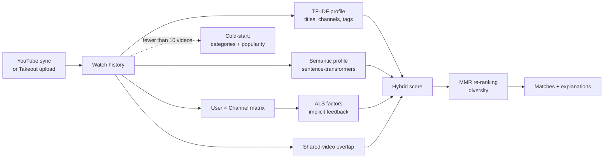

# Social Search — hybrid people recommender

Finds people with similar interests from their YouTube watch history. A user connects YouTube (Google OAuth) or uploads a Google Takeout export, the system builds an interest profile, ranks other users by a hybrid similarity score, explains every match, and lets matched people talk in real-time chat.

Bachelor's thesis project, built as a complete product: FastAPI backend, React frontend, Docker deployment.

## How ranking works



**Profiles.** Each user gets two vectors from their history: a TF-IDF vector over video titles, channels, tags and categories, and a dense embedding from a sentence-transformer (`all-MiniLM-L6-v2` by default). Recent views weigh more: exponential time decay with a half-life of about 35 days.

**Collaborative signal.** A User × Channel matrix is factorised with ALS (`implicit`, 32 factors, confidence α = 40), so users who watch the same channels end up close even when their video titles differ.

**Hybrid score.**

```
score = w_content · cos(profile_a, profile_b)
      + w_overlap · |videos_a ∩ videos_b| / min(|videos_a|, |videos_b|)
      + w_als     · sim(als_a, als_b)
```

Weights start at 0.7 / 0.3 and are adapted per user from history size and category diversity. The ALS term is added once there is enough interaction data, and all weights are renormalised to sum to 1.

**Re-ranking.** Maximal Marginal Relevance (λ = 0.7) removes near-duplicate matches so the list is not ten copies of the same profile.

**Cold start.** Users with fewer than 10 videos get matches by shared interest categories and popularity instead of vector similarity.

**Explainability.** Every match returns its breakdown: content similarity, shared videos, collaborative similarity, the weights used and a match-strength label.

## Evaluation

Three algorithms run side by side (`tfidf`, `semantic`, `hybrid`), and an endpoint reports how much their result sets overlap and what each finds uniquely.

`backend/scripts/ab_compare_semantic_models.py` benchmarks two semantic backbones (default `all-MiniLM-L6-v2` vs `all-mpnet-base-v2`) with **Precision@1/3/5, MAP@5 and nDCG@5**, plus query latency and rebuild time, keeping `hybrid` as the production baseline.

## Product

- Onboarding: pick interests, connect YouTube, or upload a Takeout file (parsed in a background job with progress)
- Feed of matched people with filters, match strength and the reasons behind each match
- Real-time chat between matched users over WebSocket
- Quality metrics panel in the UI

## Stack

| Layer | Tools |
|---|---|
| ML | scikit-learn (TF-IDF), sentence-transformers, implicit (ALS), NumPy, SciPy |
| Backend | FastAPI, SQLAlchemy, Alembic, SQLite, WebSocket, Google OAuth |
| Frontend | React, TypeScript, Vite, Tailwind CSS |
| Deploy | Docker Compose, nginx |

## Run

```bash
cp backend/.env.example backend/.env
docker compose up -d --build
```

- Web app: http://localhost
- API: http://localhost:8000 (health check at `/health`)

Migrations run on container start. Set `SECRET_KEY` and the Google OAuth values in `backend/.env`; local development without Docker is described in [backend/README.md](backend/README.md).

## Layout

```
backend/app/services/ml/              profiles, ALS, similarity, MMR, cold start, explanations
backend/app/services/recommendation/  ranking pipeline and algorithm comparison
backend/app/api/                      auth, YouTube sync, recommendations, chat
backend/scripts/                      model A/B benchmark, demo data
frontend/src/                         React app
```
